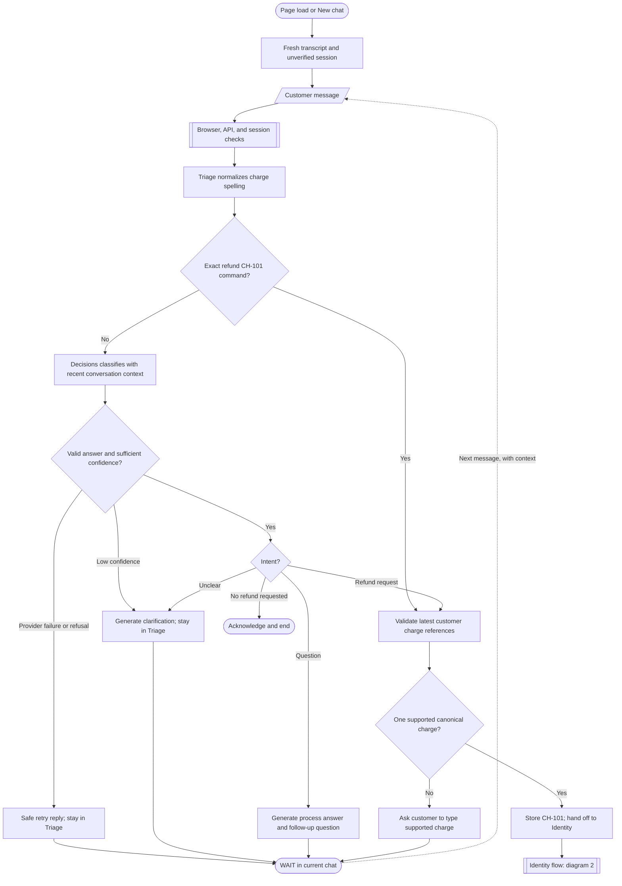
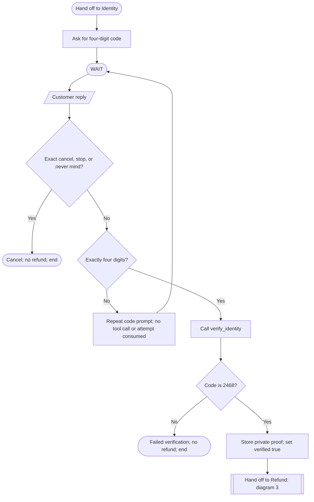
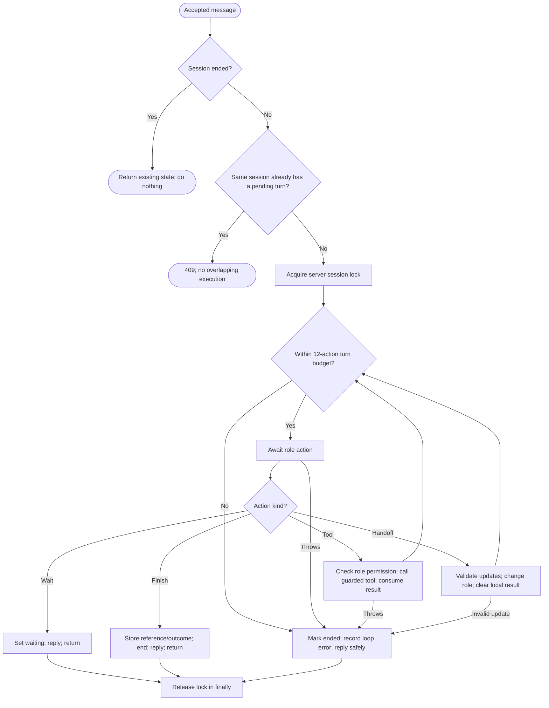
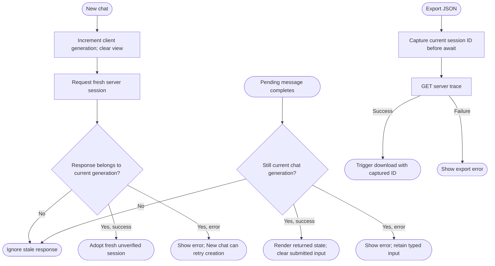

# FinchPay control-flow map

Local assignment flow, including conversation recovery and charge-level deduplication. The hosted storage variant is described in section 6. Model outputs propose intent or wording; code owns state and action authority.

Scope distinction: the assignment requires verification in the current session before a refund, plus a fresh unverified session on New chat. Cross-chat refund deduplication is an additional business rule implemented after review; it is not an explicit assignment objective.

## 1. Hybrid Triage and normal conversation



CH101, CH 101, and common hyphen variants normalize to CH-101. Repeated identical references collapse to one; distinct charges require clarification. For a follow-up yes, Triage uses recent conversation context and a charge explicitly named in earlier customer messages. The exact bare command has an explicit deterministic trace source; it is chosen before any provider call and is not an error fallback. Offline mode uses guided replies without model APIs.

## 2. Identity input handling



Repeating a refund request while waiting is a non-code message. It cannot verify identity or cause a failed attempt. An actual wrong four-digit code still ends the chat after one failed attempt. Identity turns are not sent to the models.

## 3. Refund action and shared charge ledger (deduplication extension)

```mermaid
flowchart TD
    call([issue_refund called]) --> auth{Verified flag and same-session proof?}
    auth -->|No| denied([Record denial; throw; no write])
    auth -->|Yes| charge{Requested charge matches CH-101?}
    charge -->|No| denied
    charge -->|Yes| exists{Charge already refunded in this process?}
    exists -->|No| write[Create one USD 25 record keyed by charge]
    write --> created[Return reference and created=true]
    created --> success([Deterministic issued message; end])
    exists -->|Yes| reuse[Return existing reference and created=false; no write]
    reuse --> already([Deterministic already-refunded message; end])
    newChat([New chat]) --> fresh[Reset verification; preserve charge ledger]
    fresh --> identity[[Require Identity verification again]]
    identity --> call
```

The verification guard is an assignment requirement. The subsequent shared-ledger lookup and already-refunded branch are the additional deduplication rule. The tool checks verification before looking up an existing reference, and never returns another session's bearer handle. Under this extension, New chat cannot create new eligibility for this single mock customer. A server restart clears all in-memory state; durable eligibility and provider idempotency would be needed for real payments.

## 4. Reply generation, loop, and API safeguards



Triage may make one eight-second Decisions call and, for a conversational wait, one eight-second Responses call. Responses requests strict JSON, bounded output, store=false, and no tools. A generation failure/refusal/incomplete/invalid output uses guided fallback wording; it never grants authority. Display filtering is heuristic, not factual proof. Calls end at a wait, so no model loop runs while the customer is absent.

Before execution, the API rejects cross-origin requests (403), malformed bodies/extra fields (400), oversized bodies (413), missing sessions or unsupported routes (404). Only message text is accepted from the browser. Initial session creation accepts an empty object. Static routes serve only the fixed HTML/JS/CSS allowlist; .env is inaccessible. Trace GET returns recorded state/events and refunds created by that session, including during a pending turn.

## 5. Browser reset, pending replies, and export



New chat resets session-scoped verification, never charge-level payment history. It does not cancel already-received server work, revoke old session handles, or undo a completed refund. Client generation checks prevent an old message reply from repopulating the fresh conversation. Export errors are not generation-checked; download delivery/cancellation is not observed by the app. These remain documented UI limits.

Source: src/charges.ts, agents.ts, decisions.ts, triage-replies.ts, loop.ts, tools.ts, session.ts, server.ts, and web/app.ts.


## 6. Hosted storage variant

The role decisions in the diagrams stay the same on Vercel. Before a session operation, `src/hosted.ts` hashes the secure visitor cookie and checks ownership. Message requests claim an expiring Supabase turn lease; overlapping requests receive 409. The loop awaits persistent tools: verification records server-owned proof, and the refund RPC checks that proof, the active lease, and the selected charge before an atomic insert-or-return. A database uniqueness constraint applies per visitor workspace and charge. A new visitor can demonstrate a fresh refund; New chat retains the current visitor's history.

The final session snapshot saves and releases the lease; errors attempt release, and crashed requests expire. Stale lease holders cannot write or release a replacement claim. A committed refund survives a failed snapshot save, and subsequent verified requests return its existing reference. Wrong-code failure also survives that crash window. Stored traces may be incomplete after a crash. The original synchronous store and process-restart limitation apply only to the local adapter. See DEPLOYMENT.md for configuration and scope.
